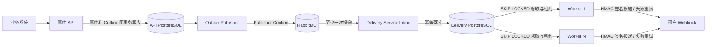

# RelayBox

[](https://github.com/Cattleyaaaaa/RelayBox/actions/workflows/ci.yml)

RelayBox 是一个可靠的 Webhook 事件投递服务。业务系统提交事件后，平台会匹配订阅端点、持久化投递任务、异步发送带 HMAC 签名的请求，并在失败时自动重试。

## 技术栈

- Java 17、Spring Boot 4、Maven
- PostgreSQL 17、Redis 7、RabbitMQ 4、Flyway
- Transactional Outbox、RabbitMQ 至少一次消费、幂等 Inbox
- 独立 API 与 Delivery Service 数据库
- PostgreSQL `FOR UPDATE SKIP LOCKED` 队列领取
- JDK `HttpClient`、HMAC-SHA256

## 核心设计与验证

- **避免跨服务双写丢失：** Event API 在一个 PostgreSQL 事务中写事件与 Outbox；RabbitMQ Publisher Confirm 后标记已发布，Delivery Service 用幂等 Inbox 接收至少一次消息。
- **应对投递进程崩溃：** Delivery Service 在独立 PostgreSQL 中持久化任务，以 `SKIP LOCKED`、执行租约、端点顺序和指数退避恢复投递；失败任务可进入死信并人工重放。
- **验证消息可靠性：** 24 项 API 模块测试覆盖业务规则与保留期清理；9 项 Delivery Service 消息、死信与保留期测试覆盖 Outbox NACK、Inbox 重复消费、消费端数据库短暂故障后的有界退避重试、耗尽处理以及死信持久化与重放；Compose CI 再停掉 RabbitMQ，验证中断期间事件保留且恢复后两条投递成功。
- **公开性能边界：** 本机 Docker Desktop（32 逻辑 CPU）以 200 events/s 持续 30 秒完成 6,000 个事件，API P95 16 ms、投递 P95 240 ms，0 积压、0 死信；2,000 个事件以约 618 events/s 突发提交全部接受。结果只代表本机快速接收端条件，不是最大吞吐或生产容量承诺。见[收尾复测](benchmarks/2026-10-22-revalidation.md)。

查看[架构与可靠性设计](docs/architecture.md)、[微服务边界说明](docs/microservice-architecture.md)，或直接启动下方管理台演示。

## 本地启动

Windows 上先安装并启动 Docker Desktop（推荐 WSL 2 后端）。在项目目录打开 PowerShell，设置开发用主密钥并启动应用和 PostgreSQL：

```powershell
$env:RELAYBOX_MASTER_KEY = "local-master-key"
docker compose up --build -d
docker compose ps
docker compose logs -f app
```

Compose 会构建 React 管理台、事件 API、独立的 Delivery Service、RabbitMQ、Redis，以及分别归属两个服务的 PostgreSQL。管理台地址是 `http://localhost:3005`，API 地址是 `http://localhost:8080`，RabbitMQ 管理页地址是 `http://localhost:15672`（本地开发账号 `relaybox/relaybox`）。API 数据库映射到 `localhost:5432`；Delivery Service 数据库仅在 Compose 网络内。停止容器但保留数据用 `docker compose down`。部署时请替换主密钥、服务间令牌和数据库、RabbitMQ 凭据。

前端位于 `frontend/`，由 Vite + React + TypeScript 构建，使用 React Bits 的 `BlurText` 和 `AnimatedContent` 做标题及卡片入场动画。开发时可以在该目录执行 `npm install`、`npm run dev`，Vite 会把 `/api` 与 `/actuator` 代理到 `localhost:8080`；Docker 环境由 Nginx 提供静态页面并反向代理 API，浏览器不需要配置跨域。

管理台的“演示中心”可运行自动重试、死信与人工重放、HTTP 400 永久失败快速终止场景，还会展示 Delivery Service 故障接管、接收端请求和幂等结果。API 在自己的数据库事务中保存事件和 Outbox，再由 RabbitMQ 交给 Delivery Service；该服务将消息幂等落入自己的数据库后执行投递。运行前确保 API、RabbitMQ、Delivery Service 与两个 PostgreSQL 容器健康，并在管理台连接时保留主密钥。

API 与 Delivery Service 独立部署并拥有不同数据库。API 在事务中保存业务事件和 Outbox 记录，发布器等待 RabbitMQ publisher confirm 后标记消息；Delivery Service 通过幂等 Inbox 消费，再把投递任务写入自己的 PostgreSQL 队列。可横向扩展 Delivery Service 副本：

```powershell
docker compose up -d --scale delivery-service=3
docker compose ps
```

RabbitMQ 的单活消费者保留事件摄取顺序；各 Delivery Service 副本里的 Worker 通过独立数据库的行锁和 `SKIP LOCKED` 并发领取任务。`WORKER_CONCURRENCY`、`WORKER_MAX_CONCURRENCY`、`WORKER_QUEUE_CAPACITY` 配置每副本执行能力；`WORKER_POLL_INTERVAL_MS` 默认 250 ms。增加 Delivery Service 副本扩展投递执行能力，不会连带扩容 API。



Compose 开发环境启用了本地测试接收器：管理接口仅接受主密钥，投递目标使用容器内地址 `http://app:8080/dev/receiver/deliver`。普通重试场景默认在三次请求后返回 `200`，并将最近 100 次请求留在内存中。专用崩溃恢复场景使用 `/dev/receiver/chaos/*`，并把演示业务效果和投递 ID 写入 PostgreSQL 唯一键表，以验证接收端重启后的持久化去重。这些接收器仅用于本地演示，不要在生产环境启用。Compose 将最大尝试次数设为 3、重试基准间隔设为 1 秒，以便快速演示；应用未设置这些环境变量时仍默认为 8 次和 5 秒基准间隔。

如果只想用 Docker 启 PostgreSQL、在本机运行 Java，可用 `docker compose up -d postgres`，然后执行 `mvn "-Dmaven.repo.local=.m2/repository" spring-boot:run`。

## 快速演示

Docker Compose 服务启动后，可以一条命令跑完重试、死信、重放、熔断恢复和租户限流演示。脚本使用唯一租户名，不打印签发的 API Key：

```powershell
.\scripts\demo.ps1
```

如果设置了自定义主密钥或 API 地址，可显式传入：

```powershell
.\scripts\demo.ps1 -BaseUrl "http://localhost:8080" -MasterKey $env:RELAYBOX_MASTER_KEY
```

脚本会轮询持久化投递状态，最长等待 120 秒；Docker Compose 默认重试策略下通常数秒即可完成。

先用主密钥创建租户。创建响应只返回一次租户 API Key；平台只保存它的 SHA-256 摘要。之后管理该租户的端点和事件时，都在 `X-API-Key` 中使用这个租户密钥。PowerShell 示例：

```powershell
$adminHeaders = @{ "X-API-Key" = "local-master-key" }
$tenant = Invoke-RestMethod -Method Post -Uri http://localhost:8080/api/v1/tenants `
  -Headers $adminHeaders -ContentType "application/json" -Body '{"name":"demo-shop"}'
$headers = @{ "X-API-Key" = $tenant.apiKey }
$endpoint = Invoke-RestMethod -Method Post -Uri http://localhost:8080/api/v1/endpoints `
  -Headers $headers -ContentType "application/json" `
  -Body '{"url":"https://example.com/webhook","eventTypes":["order.paid"]}'
$endpoint
```

创建业务事件：

```powershell
$event = Invoke-RestMethod -Method Post -Uri http://localhost:8080/api/v1/events `
  -Headers $headers -ContentType "application/json" `
  -Body '{"type":"order.paid","idempotencyKey":"order-2026-0001-paid","payload":{"orderId":"2026-0001","amount":12900}}'
$event
```

响应里的 `eventId` 可用于查询投递记录：

```powershell
Invoke-RestMethod -Uri "http://localhost:8080/api/v1/events/$($event.eventId)/deliveries" -Headers $headers
```

端点创建响应中的 `signingSecret` 只在创建时返回。接收方按 `Base64URL 解码后的密钥` 对 `时间戳 + "." + 原始请求体` 做 HMAC-SHA256，并将小写十六进制结果与 `X-Webhook-Signature` 的 `v1=` 值比较。请求还会带 `X-Webhook-Id`、`X-Webhook-Delivery` 和 `X-Webhook-Timestamp`。

## 重试、死信和重放演示

下面的本地演示让测试接收器前两次返回 HTTP 500，第三次返回 200。先配置接收器，再为租户注册本地接收地址并发布事件：

```powershell
$adminHeaders = @{ "X-API-Key" = "local-master-key" }
$tenant = Invoke-RestMethod -Method Post -Uri http://localhost:8080/api/v1/tenants `
  -Headers $adminHeaders -ContentType "application/json" `
  -Body ('{"name":"retry-demo-' + [guid]::NewGuid().ToString('N') + '"}')
$headers = @{ "X-API-Key" = $tenant.apiKey }
Invoke-RestMethod -Method Post -Uri http://localhost:8080/dev/receiver/config `
  -Headers $adminHeaders -ContentType "application/json" `
  -Body '{"failuresBeforeSuccess":2,"failureStatus":500}'
$endpoint = Invoke-RestMethod -Method Post -Uri http://localhost:8080/api/v1/endpoints `
  -Headers $headers -ContentType "application/json" `
  -Body '{"url":"http://app:8080/dev/receiver/deliver","eventTypes":["order.paid"]}'
$event = Invoke-RestMethod -Method Post -Uri http://localhost:8080/api/v1/events `
  -Headers $headers -ContentType "application/json" `
  -Body ('{"type":"order.paid","idempotencyKey":"' + [guid]::NewGuid().ToString() + '","payload":{"orderId":"demo-1001"}}')
Start-Sleep -Seconds 6
$deliveries = Invoke-RestMethod -Uri "http://localhost:8080/api/v1/events/$($event.eventId)/deliveries" -Headers $headers
$deliveries | Format-Table
Invoke-RestMethod -Uri http://localhost:8080/dev/receiver/state -Headers $adminHeaders
```

投递记录应显示 `SUCCEEDED` 且 `attemptCount` 为 3。查看单次尝试可调用 `/api/v1/deliveries/{deliveryId}/attempts`。下面再让接收器持续返回 500，观察投递进入死信，然后恢复接收器并重放：

```powershell
Invoke-RestMethod -Method Post -Uri http://localhost:8080/dev/receiver/config `
  -Headers $adminHeaders -ContentType "application/json" `
  -Body '{"failuresBeforeSuccess":100,"failureStatus":500}'
$deadEvent = Invoke-RestMethod -Method Post -Uri http://localhost:8080/api/v1/events `
  -Headers $headers -ContentType "application/json" `
  -Body ('{"type":"order.paid","idempotencyKey":"' + [guid]::NewGuid().ToString() + '","payload":{"orderId":"demo-1002"}}')
Start-Sleep -Seconds 6
$deadDelivery = (Invoke-RestMethod -Uri "http://localhost:8080/api/v1/events/$($deadEvent.eventId)/deliveries" -Headers $headers)[0]
$deadDelivery | Format-List
Invoke-RestMethod -Method Post -Uri http://localhost:8080/dev/receiver/config `
  -Headers $adminHeaders -ContentType "application/json" `
  -Body '{"failuresBeforeSuccess":0,"failureStatus":500}'
Invoke-RestMethod -Method Post -Uri "http://localhost:8080/api/v1/deliveries/$($deadDelivery.id)/replay" -Headers $headers
Start-Sleep -Seconds 2
Invoke-RestMethod -Uri "http://localhost:8080/api/v1/events/$($deadEvent.eventId)/deliveries" -Headers $headers | Format-Table
```

Compose 演示默认三次失败后标记为 `DEAD`，然后能在不丢失旧尝试记录的情况下重放。配置、状态接口都需要 `X-API-Key` 主密钥。

## 集成测试

API 集成测试通过兼容配置运行旧的单体 Worker 路径，覆盖事件幂等、自动重试、死信重放、租户隔离、API Key 轮换与过期、并发配额、Webhook 目标校验、`SKIP LOCKED` 并发领取、端点顺序、熔断、租约恢复、本地容量失败隔离、端点更新/删除/密钥轮换、payload 上限和 admin 鉴权。Delivery Service 消息测试覆盖 Publisher NACK 与隔离、重复 Inbox 消息、数据库短暂故障后的重试成功、重试耗尽后将异常交给 Listener 容器（其配置会拒绝重入队并由队列死信策略处理），以及死信持久化与重放。独立服务间的 Outbox/RabbitMQ/Inbox 交接由 Compose CI 端到端验证，包含 RabbitMQ 停机、事件暂存、broker 恢复和投递成功检查。GitHub Actions 会执行以上测试；首次运行会下载 Maven 依赖：

```powershell
docker compose --profile test run --rm integration-tests
```

测试数据库与开发数据库分开。测试 PostgreSQL 对外映射到 `127.0.0.1:55432`，方便需要时从 IDE 连接；测试结束后可用 `docker compose stop postgres-test` 停止它，不会影响正在运行的 RelayBox 开发服务。

本机固定速率投递压测的方法、原始数据与可用于性能说明的限定表述见 [压测记录](benchmarks/README.md)、[2026-10-22 收尾复测](benchmarks/2026-10-22-revalidation.md)、[轮询间隔调优记录](benchmarks/2026-10-19-polling.md) 和 [Outbox 与投递队列调优](benchmarks/2026-10-19-outbox-queue-tuning.md)。最终配置下 200 events/s 已用 6,000 个事件验证稳态；记录区分 API 接受速率、队列积压和最终投递延迟。

服务边界、Outbox/InBox 投递流程、消息顺序及故障语义见 [微服务架构说明](docs/microservice-architecture.md)。生产容量评估步骤、扩容判据和 Compose 开发环境的上线边界见 [容量评估与生产部署边界](docs/production-capacity.md)。Webhook 接收端的签名校验、事务幂等步骤和外部副作用限制见 [接收端幂等实现](docs/receiver-idempotency.md)。

租户事件入口使用 Redis Lua 令牌桶平滑突发流量，并由 PostgreSQL 固定窗口额度提供持久硬上限；配置、失败降级和监控指标见 [租户限流设计](docs/rate-limiting.md)。

## Delivery Service 崩溃接管演示

在本地 Compose 环境运行 `scripts/chaos-recovery.ps1`，可复现“请求已经到达接收方，但 Delivery Service 尚未收到响应就崩溃”的场景。脚本会暂时停止正常 Delivery Service，用两个独立的一次性容器完成故障注入，最后恢复原有副本数。管理台“演示中心”会自动更新故障现场。不要在生产环境运行此脚本。

```powershell
.\scripts\chaos-recovery.ps1
```

若使用自定义主密钥，传入 `-MasterKey $env:RELAYBOX_MASTER_KEY`。脚本会把租约仅对演示容器缩短到 12 秒，接收端扣住第一次响应 30 秒；容器 A 发出请求后被强制终止，容器 B 在租约到期后恢复投递。成功时会看到第一条尝试因租约过期标记为 `FAILED`、第二条尝试为 `SUCCEEDED`，接收方收到两次相同投递 ID 的请求，演示接收端用该 ID 去重后只应用一次业务效果。结果保存在 `benchmarks/results/chaos-*.json`。详细说明见 [故障接管演示](benchmarks/chaos-recovery.md)。

从其他 IDEA 项目或任意 PowerShell 目录运行时，也可以调用脚本绝对路径；脚本会自行定位 RelayBox 根目录。例如：`& 'D:\DeskTop\后端学习\backend\scripts\chaos-recovery.ps1'`。

现场演示前建议先阅读 [故障接管演示](benchmarks/chaos-recovery.md) 和 [容量边界](docs/production-capacity.md)。

GitHub Actions 在每次推送和 Pull Request 上运行两项独立检查：PostgreSQL 支持的 API 集成测试，以及完整 Compose 栈的 RabbitMQ 中断恢复验证。状态见页面顶部的 CI 徽章。

## API

| 方法 | 路径 | 说明 |
| --- | --- | --- |
| `POST` | `/api/v1/tenants` | 使用主密钥创建租户，并签发一次性 API Key；可配置 `eventRateLimitPerMinute` |
| `POST` | `/api/v1/tenants/api-key/rotate` | 用当前租户密钥轮换 API Key，可设置旧密钥宽限期 |
| `POST` | `/api/v1/endpoints` | 注册订阅端点，返回一次性签名密钥 |
| `GET` | `/api/v1/endpoints` | 列出端点 |
| `PATCH` | `/api/v1/endpoints/{endpointId}` | 暂停或恢复端点（`{"enabled":false}` / `{"enabled":true}`） |
| `PUT` | `/api/v1/endpoints/{endpointId}` | 更新端点 URL、事件类型与熔断参数 |
| `DELETE` | `/api/v1/endpoints/{endpointId}` | 软删除端点；之后的新事件不再包含它 |
| `POST` | `/api/v1/endpoints/{endpointId}/secret/rotate` | 轮换签名密钥，只返回一次新密钥 |
| `POST` | `/api/v1/events` | 发布事件；同一幂等键只创建一次事件 |
| `GET` | `/api/v1/events/{eventId}/deliveries` | 查看事件的投递状态 |
| `GET` | `/api/v1/deliveries/{deliveryId}/attempts` | 查看逐次投递尝试、状态码与耗时 |
| `POST` | `/api/v1/deliveries/{deliveryId}/replay` | 重放已完成或进入死信的投递 |
| `GET` | `/api/v1/admin/outbox?status=pending\|abandoned\|published` | 主密钥：查看 Outbox 待发布、已隔离或已发布记录 |
| `POST` | `/api/v1/admin/outbox/{eventId}/retry` | 主密钥：把隔离的 Outbox 事件重新排队 |
| `POST` | `/api/v1/admin/outbox/{eventId}/abandon` | 主密钥：人工隔离持续阻塞的 Outbox 事件 |
| `GET` | `/api/v1/admin/dead-letters` | 主密钥：查看已持久化的 RabbitMQ 死信 |
| `POST` | `/api/v1/admin/dead-letters/{id}/replay` | 主密钥：重放一条死信 |
| `GET` | `/actuator/health` | 健康检查 |
| `GET` | `/actuator/metrics/relaybox.delivery.queue.depth` | 查看待处理、执行中和死信队列深度 |
| `GET` | `/actuator/metrics/relaybox.delivery.queue.oldest.pending.age` | 查看最老待处理投递的等待秒数 |
| `GET` | `/actuator/metrics/relaybox.delivery.attempts` | 查看投递成功、重试和死信计数 |

## 投递语义

每个租户使用独立 API Key，API 数据库只保存密钥摘要。事件幂等键按租户唯一；重复提交相同类型和 JSON 内容返回原事件，不同内容或类型返回 HTTP 409。API 在一个 PostgreSQL 事务中写入事件与 Outbox，发布器等待 RabbitMQ confirm 后标记已发布；Delivery Service 使用唯一 Inbox 事件 ID，事务性写入事件快照和投递任务。读取与重放通过带内部令牌的 API 调用 Delivery Service，并带租户条件。Worker 以 `SKIP LOCKED`、执行租约和端点序号处理投递，失败按指数退避重试并记录尝试。消息跨服务至少一次交付；Webhook 的网络结果仍不能保证端到端 exactly-once，接收方应使用投递 ID 做持久化幂等。

租户可通过 `POST /api/v1/tenants/api-key/rotate` 轮换密钥。请求体中的 `gracePeriodSeconds` 可设为 0–86400 秒，缺省为 300 秒；响应只返回一次新密钥。宽限期内旧、新密钥均可调用租户 API，但仅当前密钥可以再次轮换。宽限期结束后旧密钥自动失效；设为 0 则立即撤销旧密钥。数据库仅保存当前和过渡期旧密钥的 SHA-256 摘要。

事件发布还支持每租户独立的分钟硬配额。创建租户时可在请求中设置 `eventRateLimitPerMinute`（1–10000），不传则使用默认 120 次/分钟。事件入口先通过 Redis Lua 令牌桶平滑短突发，再由 PostgreSQL 原子 upsert 计入共享的固定分钟硬配额；Redis 故障时降级到 PostgreSQL 限额。超额请求返回 HTTP 429 与 `Retry-After`，分钟限额通过 `X-RateLimit-Limit`、`X-RateLimit-Remaining` 返回，Redis 令牌余额通过 `X-RateLimit-Burst-Remaining` 返回。重复发布也计入请求配额，避免通过幂等键绕过入口流量限制。Redis 突发限流的配置和故障指标见 [租户限流设计](docs/rate-limiting.md)。

Webhook 目标默认必须是 HTTP/HTTPS，且解析后不能指向回环、内网、链路本地、组播或保留地址；创建端点和发送请求前都会检查。项目的本地 Compose 演示需要访问容器内的测试接收器，因此显式设置 `ALLOW_PRIVATE_WEBHOOK_TARGETS=true`。部署到可访问外网的环境时应保持默认 `false`，并配合网络层出口规则限制服务可访问的网段。

端点可以按租户暂停或恢复，也可以通过 `PUT` 更新 URL、事件类型与熔断参数，或用 `DELETE` 软删除；`POST /endpoints/{id}/secret/rotate` 只返回一次新签名密钥。这些变更只影响之后接受的事件；已经随事件快照进入 Delivery Service 的投递会继续使用旧地址和旧密钥。端点列表包含启停状态，租户不能修改其他租户的端点。

每个端点维护独立的熔断器：连续失败达到 `circuitFailureThreshold` 后进入 `OPEN`，冷却 `circuitOpenDurationSeconds` 后转为 `HALF_OPEN`。多个 Worker 通过数据库端点级探测租约协调，冷却后同一端点只放行一个探测投递；成功恢复为 `CLOSED` 并清零失败计数，失败则重新打开熔断器。端点创建请求可设置这两个字段，默认分别为 5 次和 30 秒；`GET /api/v1/endpoints` 会返回熔断状态、连续失败数和冷却截止时间。相关默认值可通过 `CIRCUIT_FAILURE_THRESHOLD` 和 `CIRCUIT_OPEN_DURATION_SECONDS` 调整。

投递记录和尝试历史使用有上限的 offset 分页：默认 `limit=50&offset=0`，每页最多 100 条。响应包含 `items`、`limit`、`offset` 和 `hasMore`；排序附带唯一 ID，保证相同时间戳下仍可稳定翻页。例如：`GET /api/v1/events/{eventId}/deliveries?limit=20&offset=0`。

每个端点有单调递增的投递序号。RabbitMQ 单活消费者按 Outbox 次序摄取消息，Delivery Service 为目标端点分配序号；Worker 只领取该端点最早的未完成投递，因此同一端点上的事件按序发送。头部投递失败时会继续重试并阻塞后续序号；成功或进入死信后队列继续前进。人工重放会获得新序号并排到端点队尾。

Delivery Service 队列由其 PostgreSQL 数据库持久化：多个副本的 worker 使用 `FOR UPDATE SKIP LOCKED` 领取互不重叠的任务；任务带两分钟租约。租约过期后，下次轮询会关闭遗留的 `IN_FLIGHT` 尝试并按剩余次数重新入队，达到上限则转为 `DEAD`。服务内队列集成测试覆盖同端点顺序与重试阻塞、跨端点并行领取、强制过期租约和尝试次数耗尽；Compose CI 还会验证 RabbitMQ 中断期间 Outbox 暂存、broker 恢复后 Inbox 接收及最终投递成功。

## 失败隔离与运维

Outbox 发布器为每条事件记录 `attempts`、`next_attempt_at`、`failure_kind` 和 `last_error`。失败按 200 ms 起、上限 60 秒的指数退避重试；重试期间该事件仍占据队头，后续事件不会越过它，从而保持端点投递顺序。

自动隔离只针对确定性的消息转换失败：达到 `OUTBOX_MAX_ATTEMPTS`（默认 50）后写入 `abandoned_at` 并继续发布后续事件，同时累加 `relaybox.outbox.messages.quarantined` 与 `relaybox.outbox.quarantined` 指标。broker 不可用、NACK、路由失败属于基础设施故障，继续阻塞而不是隔离，避免在故障期间丢事件。持续阻塞的事件由运维通过主密钥接口处理：

```powershell
$admin = @{ "X-API-Key" = $env:RELAYBOX_MASTER_KEY }
Invoke-RestMethod -Uri "http://localhost:8080/api/v1/admin/outbox?status=abandoned" -Headers $admin
Invoke-RestMethod -Method Post -Uri "http://localhost:8080/api/v1/admin/outbox/<eventId>/retry" -Headers $admin
```

RabbitMQ 死信队列 `relaybox.delivery.events.dead` 由 Delivery Service 消费并持久化到自己的 `dead_letter_message` 表；消息指纹用于吸收「已落库但未来得及 ack」的重复投递，数据库不可用时消息退回队列而不是丢弃。死信可通过 `GET /api/v1/admin/dead-letters` 查看，`POST /api/v1/admin/dead-letters/{id}/replay` 重放；重放仍经过 Inbox 去重，因此不会重复创建投递，但消息本身无法解析时会再次进入死信。

Worker 线程池饱和或进程中断属于本地失败，不计入端点连续失败、不触发熔断，也不消耗重试预算：任务回到 `PENDING` 并将 `max_attempts` 加一。

事件 payload 默认限制为 256 KiB（`MAX_PAYLOAD_BYTES`）；超过时在写入事件前返回 HTTP 400，避免超大消息放大 Outbox、broker 和接收端成本。

## 数据保留与清理

两个服务各自运行保留期清理任务，默认关闭。`RETENTION_ENABLED=true` 开启后，任务按窗口分批删除终态历史；`RETENTION_DRY_RUN` 默认仍为 `true`，只统计并写日志，确认数量后再设为 `false`。

| 配置 | 默认 | 清理对象 |
| --- | --- | --- |
| `RETENTION_OUTBOX_PUBLISHED_DAYS` | 7 | 已发布的 Outbox 记录 |
| `RETENTION_OUTBOX_ABANDONED_DAYS` | 30 | 已隔离的 Outbox 记录 |
| `RETENTION_DELIVERY_TERMINAL_DAYS` | 30 | `SUCCEEDED` / `DEAD` 投递及其尝试记录 |
| `RETENTION_EVENT_DAYS` | 90 | 不再被 Outbox 或投递引用的事件 |
| `RETENTION_INBOX_DAYS` | 30 | Delivery Service 的 Inbox 去重记录 |
| `RETENTION_DEAD_LETTER_REPLAYED_DAYS` | 30 | 已重放的死信 |
| `RETENTION_BATCH_SIZE` | 500 | 单批删除行数 |
| `RETENTION_INTERVAL_MS` | 3600000 | 调度间隔（毫秒） |
| `RETENTION_INITIAL_DELAY_MS` | 60000 | 首次执行延迟（毫秒） |

`RETENTION_EVENT_DAYS` 同时是事件幂等键的保留窗口：事件被清理后，同一 `idempotency_key` 可以再次创建事件。`RETENTION_INBOX_DAYS` 同时是 Delivery Service 的消费去重窗口；如果 RabbitMQ 可能保留消息超过该窗口，应调大此值。需要更长幂等期时，应调大窗口或把幂等键迁移到独立表。

清理顺序是 Outbox → 尝试 → 终态投递 → 事件；Delivery 侧再清理 Inbox 与已重放死信。`PENDING` / `IN_FLIGHT` 投递、未发布且未隔离的 Outbox、未重放的死信，以及仍被 Outbox 或投递引用的事件永远不会被选中。每批独立提交，避免长事务；拆分模式下两个数据库各自由所属服务清理，单体兼容路径中的投递历史由 API 清理。保留期索引见 API 的 `V12__retention_indexes.sql` 与 Delivery 的 `V4__retention_indexes.sql`。

建议先用 dry-run 观察一轮：

```powershell
$env:RETENTION_ENABLED = "true"
$env:RETENTION_DRY_RUN = "true"
docker compose up -d
docker compose logs -f app delivery-service | Select-String "Retention"
```

日志会给出每类数据的待删除数量；确认后再设 `RETENTION_DRY_RUN=false` 并重启服务。

## 当前边界与下一步

- API 集成测试仍使用兼容的单体 Worker 配置；Delivery Service 目前由队列集成测试和 Compose 故障恢复作业覆盖，后续可补全独立服务的契约测试与更细粒度故障注入。
- 单体兼容路径与 Delivery Service 仍各自维护一份 `DeliveryQueue`、`DeliveryWorker` 和 `WebhookTargetPolicy`，后续应抽成共享模块或移除兼容路径。
- 保留期清理默认关闭，需要按环境显式开启并先跑 dry-run；历史数据归档到对象存储或数仓尚未实现，长期审计需要外接数据管道。
- 自动隔离只覆盖确定性消息转换失败；broker/拓扑类持续故障会有意阻塞 Outbox，需要借助 `relaybox.outbox.unpublished` 告警和 admin 接口处置。
- Outbox 发布器仍在事务内等待 publisher confirm；broker 延迟高时事务和单发布者锁会限制吞吐，后续可改为逐条独立事务或异步 confirm 状态机。
- 端点暂停、删除和签名密钥轮换只影响新事件；轮换期间接收端需要同时接受新旧密钥，直到旧快照投递完成。
- 当前基准已覆盖本机 200 events/s 稳态与 2,000 事件突发，并结合历史记录观察到 275 events/s 起出现 Outbox 积压；但尚未做多轮重复、长时间 soak 和容器/数据库/RabbitMQ 资源曲线，不能据此给出生产容量或多副本线性扩容结论。
- 生产部署仍需补充凭据管理、出口网络策略、备份恢复、审计与告警，并在目标环境重新做容量验证。
