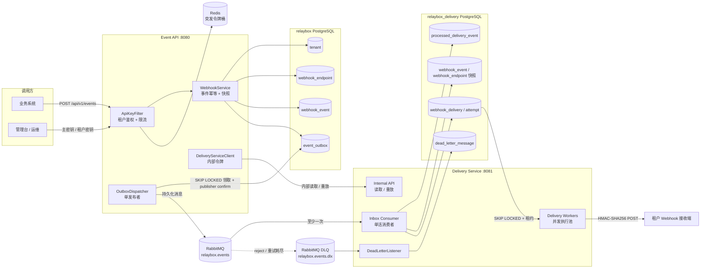
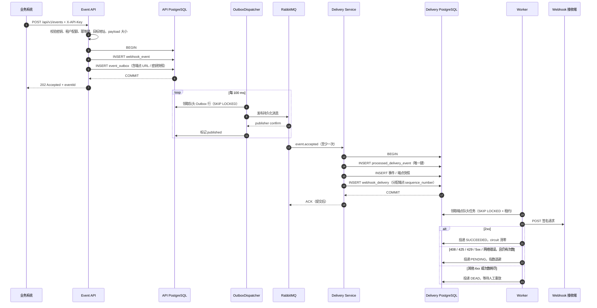

# RelayBox 架构与可靠性设计

本文是代码评审和交接用的架构主线：一次事件如何从 HTTP 请求变成带签名的 Webhook 投递，以及每个故障窗口由什么机制兜底。

## 1. 部署拓扑

关键点：

- API 与 Delivery Service 是**两个可独立部署的进程**，各自拥有 PostgreSQL；它们之间没有跨库事务。
- Redis 只承担突发令牌桶，PostgreSQL 固定窗口配额仍是持久硬上限；Redis 故障时降级到 PostgreSQL。
- RabbitMQ 负责跨服务的事件交接；Delivery Service 内部数据库负责投递任务、重试、熔断和租约。
- `webhook_endpoint` 和 `webhook_event` 在 Delivery 库中是**快照**，不是 API 库的副本；这样 API 暂时不可用时投递仍可继续。

## 2. 数据所有权

| 服务 | 核心表 | 职责 |
| --- | --- | --- |
| Event API | `tenant`、`webhook_endpoint`、`webhook_event`、`event_outbox`、`tenant_event_rate_limit` | 租户与密钥、订阅关系、事件幂等、待发布消息、入口配额 |
| Delivery Service | `processed_delivery_event`、`webhook_event`（快照）、`webhook_endpoint`（快照）、`webhook_delivery`、`webhook_delivery_attempt`、`dead_letter_message` | 消费去重、投递状态机、尝试历史、熔断、死信 |

API 库仍保留旧的投递表，仅用于单体兼容路径和历史数据；Compose 新模式的新投递只写 Delivery 库。

## 3. 一次事件的完整路径

当前实现有一个刻意保留的边界：Outbox 发布器在**同一个数据库事务内**等待 publisher confirm，然后标记 published。它避免了“消息已确认但状态未提交”的窗口，但 broker 延迟会占用事务和单发布者锁，是后续可优化的点。

## 4. 关键决策与取舍

| 问题 | 选择 | 原因 | 代价 / 边界 |
| --- | --- | --- | --- |
| 事件已落库、消息未发出 | Transactional Outbox | 业务写入与待发消息同事务，避免双写丢失；不需要 2PC | 至少一次，可能重复发布；需要 Inbox 去重 |
| 重复消息 | Inbox 唯一键 | `processed_delivery_event` 与投递创建同事务，重复消费无副作用 | 去重窗口受保留期限制 |
| 跨服务一致性 | 不用分布式事务 | 两个数据库独立部署，2PC 成本和可用性代价高 | 状态短暂不一致，查询/重放走内部 API |
| 同一端点顺序 | 单活消费者 + 每端点 `sequence_number` | 端点内严格有序；不同端点可并行 | 热端点近似串行，扩 Worker 不能提升单端点吞吐 |
| Worker 崩溃 | 120 秒租约 + 过期尝试关闭 + 重试 | 进程崩溃后另一个副本可接管 | 接收端可能收到重复请求，必须按投递 ID 幂等 |
| 失败重试 | 指数退避 + 抖动 | 避免瞬时故障放大和重试风暴 | 长退避会拉长端到端延迟 |
| 永久失败 | 4xx 不重试，直接 DEAD | 参数/鉴权错误重试没有意义 | 需要人工修复后 replay |
| 熔断 | 端点级 CLOSED / OPEN / HALF_OPEN | 故障端点不拖垮其他端点；半开只放一个探测 | 半开探测失败会重新 OPEN |
| 入口限流 | Redis 令牌桶 + PostgreSQL 固定窗口 | Redis 平滑突发，PostgreSQL 提供持久硬上限 | 两层语义需要文档和监控对齐 |
| 保留期 | 按窗口分批清理，默认关闭 + dry-run | 避免误删，控制表单膨胀 | 事件窗口同时是幂等窗口，不能随意缩短 |

## 5. 故障矩阵

| 故障 | 影响 | 恢复机制 | 证据 |
| --- | --- | --- | --- |
| API 在事务提交前崩溃 | 客户端没有 202 | 客户端用同一幂等键重试 | 幂等键唯一约束 |
| API 提交后、响应前崩溃 | 客户端可能重试 | 同幂等键返回原事件 `duplicate=true` | `RelayBoxIntegrationTest` |
| 发布器在 broker 确认后、标记前崩溃 | 可能重复发布 | Inbox 唯一键吸收重复 | Delivery Consumer 测试 |
| RabbitMQ 停机 | Outbox 积压，API 仍可接收 | 发布器退避重试，恢复后继续 | Compose E2E：停机期间事件保留，恢复后投递成功 |
| 消费者提交后、ACK 前崩溃 | 消息重投 | Inbox 去重 | 重复消费测试 |
| 消费者无法落库 | 消息可能反复重试 | 5 次有界退避后进入 DLQ；落库失败时退回队列 | Delivery 消息测试、死信测试 |
| Worker 发出请求后崩溃 | 接收端可能已处理 | 租约过期→尝试 FAILED→重新入队→再次发送 | `chaos-30871c5c9926.json`：2 次请求、2 条尝试、1 次业务效果 |
| 接收端 5xx / 超时 | 投递失败 | 指数退避；达到阈值熔断；次数耗尽进 DEAD | `demo.ps1`：3 次尝试后成功 |
| 接收端 4xx | 永久失败 | 不重试，直接 DEAD | 集成测试 |
| 死信 | 消息无法消费 | 持久化到 `dead_letter_message`，主密钥接口重放 | `DeadLetterServiceTest`、Compose 验证 |
| 线程池饱和 / 进程中断 | 本地执行失败 | `defer`：不消耗重试预算、不触发熔断 | `DeliveryQueueIntegrationTest` |

## 6. 可观测性与运维入口

| 信号 | 用途 |
| --- | --- |
| `relaybox.outbox.unpublished` | Outbox 积压；持续上升说明 broker/发布器异常 |
| `relaybox.outbox.quarantined` / `messages.quarantined` | 确定性转换失败被隔离 |
| `relaybox.delivery.queue.depth` | 待处理 / 执行中 / 死信深度 |
| `relaybox.delivery.queue.oldest.pending.age` | 最老待处理任务年龄，判断是否稳态 |
| `relaybox.delivery.attempts{outcome=...}` | 成功、重试、死信、defer 比例 |
| `relaybox.delivery.deadletter.depth` | 死信积压 |
| `GET /api/v1/admin/outbox` | 主密钥查看 pending / abandoned / published |
| `GET /api/v1/admin/dead-letters` | 主密钥查看死信 |
| `POST /api/v1/admin/outbox/{eventId}/retry` | 重新排队被隔离事件 |
| `POST /api/v1/admin/dead-letters/{id}/replay` | 重放死信 |

告警建议：`outbox.unpublished > 0` 持续 5 分钟、`queue.oldest.pending.age` 持续超过 SLO、死信深度增长、5xx 比例突增、数据库连接池等待。

## 7. 已知边界

- **不是端到端 exactly-once**：HTTP 请求可能重复，接收端必须用 `X-Webhook-Delivery` 做持久化幂等。
- **单活消费者是顺序与吞吐的取舍**：RabbitMQ 消费顺序被保留，但跨副本的事件摄取不能并行；投递执行由数据库 Worker 并行。
- **热端点串行**：同一端点严格顺序意味着单端点吞吐受一次 HTTP 往返限制。
- **Outbox confirm 在事务内**：broker 延迟会放大事务持锁时间。
- **代码重复**：单体兼容路径与 Delivery Service 各有一份 `DeliveryQueue`、`DeliveryWorker`、`WebhookTargetPolicy`。
- **保留期任务无 leader 锁**：多副本同时开启会重复执行删除；当前默认关闭，开启前应只在一个实例运行或加锁。
- **没有历史归档**：超过窗口的数据直接删除，长期审计需要外接对象存储/数仓。
- **生产硬化不足**：默认凭据、actuator 暴露、TLS、备份恢复、出口网络策略仍需补齐。

相关文档：[微服务边界与交接](microservice-architecture.md)、[接收端幂等](receiver-idempotency.md)、[容量边界](production-capacity.md)。
